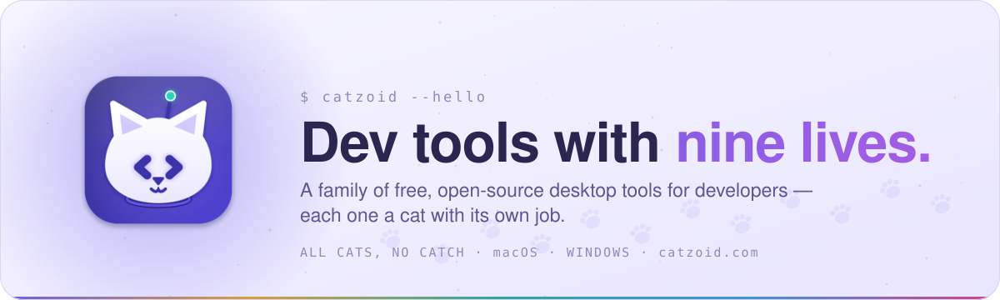
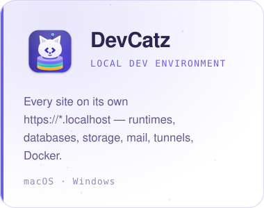
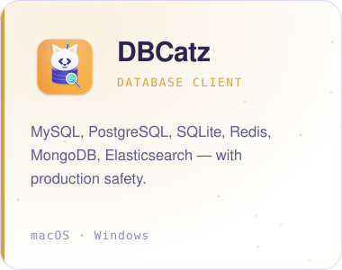
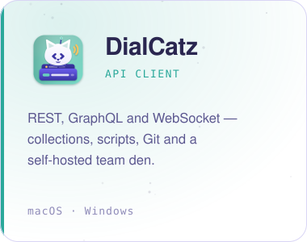
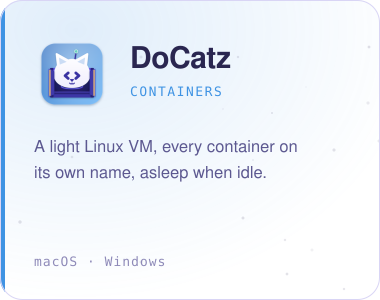
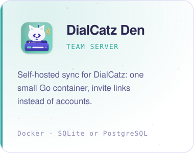
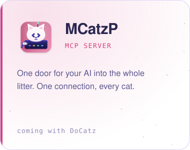
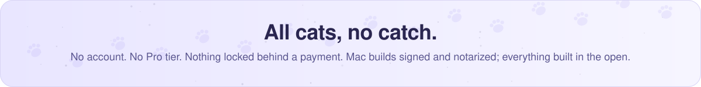

<picture>
  <source media="(prefers-color-scheme: dark)" srcset="https://github.com/catzoidhub/.github/raw/main/profile/assets/banner-dark.svg">
  
</picture>

  <a href="https://catzoid.com"><b>catzoid.com</b></a>&nbsp;&nbsp;·&nbsp;&nbsp;
  <a href="https://catzoid.com/download"><b>Download</b></a>&nbsp;&nbsp;·&nbsp;&nbsp;
  <a href="https://catzoid.com/docs"><b>Docs</b></a>&nbsp;&nbsp;·&nbsp;&nbsp;
  <a href="https://catzoid.com/community"><b>Community</b></a>&nbsp;&nbsp;·&nbsp;&nbsp;
  <a href="https://catzoid.com/roadmap"><b>Roadmap</b></a>

 

**Catzoid** is a litter of desktop apps that do the everyday work of a developer's machine — serve the sites, hold the databases, dial the APIs, carry the containers — and talk to each other while they do it. Point one at a folder; the cats handle the rest. Every app is free and open source, for **macOS** (Apple silicon and Intel) and **Windows 10+**.

 

## Meet the cats

<a href="https://github.com/catzoidhub/DevCatz"><picture><source media="(prefers-color-scheme: dark)" srcset="https://github.com/catzoidhub/.github/raw/main/profile/assets/tile-devcatz-dark.svg"></picture></a>
<a href="https://github.com/catzoidhub/DBCatz"><picture><source media="(prefers-color-scheme: dark)" srcset="https://github.com/catzoidhub/.github/raw/main/profile/assets/tile-dbcatz-dark.svg"></picture></a>
<a href="https://github.com/catzoidhub/DialCatz"><picture><source media="(prefers-color-scheme: dark)" srcset="https://github.com/catzoidhub/.github/raw/main/profile/assets/tile-dialcatz-dark.svg"></picture></a>

<a href="https://github.com/catzoidhub/DoCatz"><picture><source media="(prefers-color-scheme: dark)" srcset="https://github.com/catzoidhub/.github/raw/main/profile/assets/tile-docatz-dark.svg"></picture></a>
<a href="https://github.com/catzoidhub/DialCatz-Den"><picture><source media="(prefers-color-scheme: dark)" srcset="https://github.com/catzoidhub/.github/raw/main/profile/assets/tile-den-dark.svg"></picture></a>
<a href="https://github.com/catzoidhub/MCatzP"><picture><source media="(prefers-color-scheme: dark)" srcset="https://github.com/catzoidhub/.github/raw/main/profile/assets/tile-mcatzp-dark.svg"></picture></a>

 

## One litter, not five strays

The cats know each other. A site in DevCatz becomes an environment in DialCatz, with its Laravel routes imported as requests. A database DevCatz installed opens in DBCatz with one click, already connected. When DoCatz grows up, its databases wander into DBCatz and its HTTP services into DialCatz — and MCatzP gives your AI assistant one door into all of them.

- **Production safety** — DBCatz colours production connections, asks before a write and keeps `DELETE` without a `WHERE` from leaving the window.
- **Your keys, your machine** — AI providers, Git tokens and database passwords live in your OS keychain (Keychain on macOS, DPAPI on Windows), never in a settings file.
- **Quiet by default** — nothing phones home except the update check and, only if you turn them on, crash reports. [What the apps send →](https://catzoid.com/docs/privacy-and-data)

 

## Install

- **Download** — [catzoid.com/download](https://catzoid.com/download) picks the build for your computer. Mac builds are signed and notarized; Windows installers are built by GitHub Actions from each release tag and are [not code-signed yet](https://catzoid.com/legal/code-signing).
- **Homebrew** — `brew install --cask catzoidhub/catz/devcatz`, also `dbcatz` and `dialcatz`, from the [homebrew-catz](https://github.com/catzoidhub/homebrew-catz) tap.
- **In the app** — each cat can install its siblings from its own *Catzoid* menu.

 

## Built in the open

Every app is **GPL-3.0** (DialCatz Den **AGPL-3.0**, MCatzP **Apache-2.0**), © Mahryan Rakhmatullah, and takes pull requests under a [CLA](https://github.com/catzoidhub/DevCatz/blob/main/CLA.md). The names and the cat logos are trademarks — see each repo's `TRADEMARKS.md`. Three developers look after the litter: [Ryan](https://github.com/ryankucingg) (DevCatz and the website), Hafiz (DBCatz, DoCatz) and Wildan (DialCatz, MCatzP).

Found a bug? Use *Report a Bug* inside the app, or open an issue on the cat's repo. Want to help a cat earn its Windows signature? Star it, write about it, send a pull request — that is the recognition free code signing is given for.

 

<picture>
  <source media="(prefers-color-scheme: dark)" srcset="https://github.com/catzoidhub/.github/raw/main/profile/assets/closing-dark.svg">
  
</picture>

Made in Indonesia · <a href="https://catzoid.com/about">About</a> · <a href="https://catzoid.com/legal/privacy">Privacy</a> · <a href="https://catzoid.com/community">Community</a>

